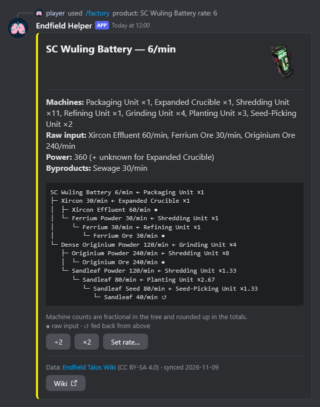

# Endfield Helper

[Add to a server](https://discord.com/oauth2/authorize?client_id=1568475342174162947&scope=bot+applications.commands&permissions=3072) ·
[Add to your account](https://discord.com/oauth2/authorize?client_id=1568475342174162947&integration_type=1&scope=applications.commands) ·
[Site](https://endfield-bot.endfield-bot.workers.dev) · [Support server](https://discord.gg/rj4GBuFXh4)



Unofficial fan project, not affiliated with GRYPHLINE or Hypergryph. Discord bot for **Arknights: Endfield**: operator/weapon/gear/item/enemy cards, AIC production-chain
calculator, banners/events/reset timers and channel notifications. Data comes from the
[Endfield Talos Wiki](https://endfield.wiki.gg) (CC BY-SA 4.0).

Runs as an HTTP-interactions app on Cloudflare Workers (no VPS, no gateway) with D1 for subscriptions.

## Commands
`/operator` `/weapon` `/gear` `/item` `/enemy` `/recipe` `/factory` `/banner` `/events` `/reset` `/wiki` `/help`
`/notify subscribe|unsubscribe|list` (Manage Server)

Replies are ephemeral with a **Show everyone** button; the app works both server-installed and user-installed.

## Languages
English (default), Russian, Ukrainian, Spanish, Japanese, Korean, Simplified and Traditional Chinese.
The language follows each user's Discord client (`interaction.locale`); channel notifications use the language chosen in
`/notify subscribe language:` (default: the server's language).

- **Translated:** the bot's interface, slash command descriptions, and the names of operators, weapons, gear, items,
  enemies and machines (from the wiki's own translations; searchable in any language).
- **Not translated:** descriptions of skills, talents, items and enemies (the wiki only has English), classes, elements,
  stats, banner and event names. Ukrainian has no wiki names, so names stay English there.
- UI strings live in `src/i18n.ts` (typed, so a missing key fails the build). They were written without a native-speaker
  review; corrections are welcome.
- Slash commands are re-registered by the worker's cron whenever `src/commands.ts` or the translations change.

## Free and Supporter
Every lookup feature is free. A server can subscribe one notification channel for free; `src/lib/entitlements.ts` holds the
limits and reads the `entitlements` table. Optional paid Supporter plans (more channels, later extras) are planned and will
run in a separate private service, so this repository stays the complete free bot.

## License
Code: [AGPL-3.0](LICENSE). Game data in `data/` is from the Endfield Talos Wiki under
[CC BY-SA 4.0](https://creativecommons.org/licenses/by-sa/4.0/); keep the attribution if you reuse it.
If you run a modified copy as a public bot, the AGPL requires you to publish your changes.

## Support
Support server: https://discord.gg/rj4GBuFXh4 (linked from `/help` and the policy pages; the link lives in `src/lib/links.ts`).

## Layout
- `pipeline/` — `npm run sync` pulls Cargo tables, page wikitext and `Module:Recipe/*` into `data/dataset.json`
- `data/overrides.json` — manual fixes: `power` (facility → power), `preferredRecipe` (item → facility)
- `src/` — worker: `index.ts` (routing), `views.ts` (all screens), `notify.ts` (cron), `lib/` (factory, search, UI)
- `scripts/` — `register.ts` (slash commands), `devkeys.ts` + `e2e.ts` (local tests with fake signed interactions)

## Local development
```sh
npm install
npm run sync                     # refresh data from the wiki
npm test                         # unit tests + every view against Discord limits
npx tsx scripts/devkeys.ts       # fake keypair -> .dev.vars
npx wrangler d1 migrations apply endfield-bot --local
npx wrangler dev                 # then: npx tsx scripts/e2e.ts
```

## Deploy
1. `npx wrangler login`
2. `npx wrangler d1 create endfield-bot` → put the id into `wrangler.toml`
3. `npx wrangler d1 migrations apply endfield-bot --remote`
4. `npx wrangler deploy`
5. Discord Developer Portal → new application:
   - `npx wrangler secret put DISCORD_PUBLIC_KEY` / `DISCORD_APP_ID` / `DISCORD_TOKEN`
   - Interactions Endpoint URL = the worker URL
   - Installation: enable Guild Install + User Install, scopes `applications.commands` + `bot`, permissions View Channel + Send Messages
6. `DISCORD_APP_ID=… DISCORD_TOKEN=… npx tsx scripts/register.ts` (add `GUILD_ID=…` for instant test-guild registration)

Nightly data refresh: `.github/workflows/sync.yml` (secrets `CLOUDFLARE_API_TOKEN`, `CLOUDFLARE_ACCOUNT_ID`).
